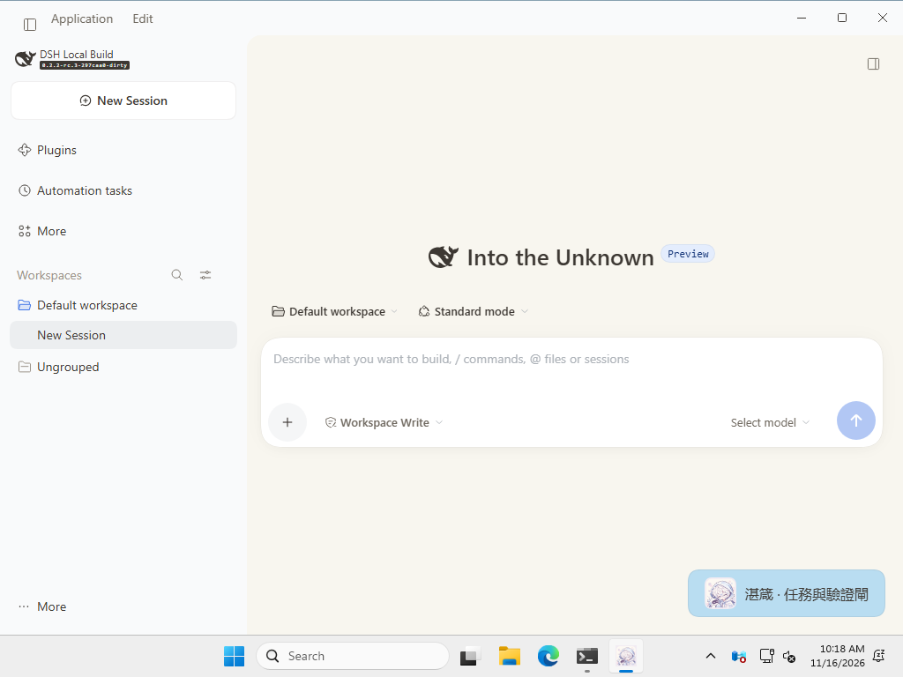

# 湛箴_ymzz


**在完整 DeepSeek Harness 上維護的本機編碼智能體：保留原生聊天、工作區與面板配置，以真正 DSH 插件增加技能、逐次授權、驗證閘與人工驗收。**

> 深淵的清澈的水，纂刻于竹篾上的痕，珍重微小，有所依據，立傳傳世

[Windows Releases](https://github.com/Ya-MiC/ymzz-zhanzhen/releases) · [執行／開發](applications/dsh/README.md) · [全部來源與要求](docs/integration/COVERAGE.md) · [真實測試證據](applications/dsh/evidence/) · [上游 DSH](https://github.com/deepseek-ai/deepseek-harness)

**下載狀態：尚無符合「全 permissive」要求的完整 DSH Windows Release。** 已產生真正 Electron EXE 並執行 GUI 任務，但 stock Electron FFmpeg（LGPL-2.1+）及 LibreOffice（MPL-2.0）阻止發佈；不能拿舊獨立 Tauri 包冒充本產品。影像管線 Sharp 已用真正 permissive 實作替代，沒有刪除影像功能。未繞過授權 gate。



上圖為完整 DSH 的真實 Windows runner 截圖，不是設計稿；**改名及原生 slot 品牌前的歷史候選版**。[該次實證與失敗界線](applications/dsh/evidence/windows-297caa0f/)。最終下載須以 Releases 的完整 GUI／任務／授權合格版本為準，目前沒有冒稱可下載的合格包。

## 三步開始（原碼預覽）

需要 Node 24.22.1、Corepack／pnpm 11.28.5、Rust 1.100.0 與本平台 C/C++ 建置工具。Windows CI 使用官方完整 Electron 打包鏈；不是 WebView2/Tauri。

```sh
cd applications/dsh
pnpm install:upstream
pnpm build && pnpm start
```

1. 第一次填暱稱，選 **雲箋淺／暗、陶土淺／暗**；原生 DSH 導覽、面板位置不變。
2. 用附加任務插件執行離線修復示例，逐次核准真實讀檔／patch／測試。先失敗再修正，檢查差異後**驗收或還原**，另行確認才記憶。示例 transport **明確是假模型，不是 live 推論**。
3. 在 DSH 原生 **Account menu → Settings → Models** 設定自己的模型；原生工作區選擇器／聊天／插件管理保留。**未配置模型 ≠ 模型已可用**；本次沒有付費／NIM 推論。

合格 portable 發佈後：從 Releases 下載完整 ZIP、解壓整個資料夾、啟動 `湛箴_ymzz.exe`。資料仍放 `湛箴資料`，身分 ID 保持 `me.yanming.zhanzhen`，不因改名另建使用者身分。不使用 NSIS／MSI、無自訂 protocol／registry persistence；不保證作業系統完全不寫 registry／快取。

## 真正載入什麼

| 模組 | 實作與目前界線 |
|---|---|
| 完整 DSH | 官方 `39163dd30f703a79079e2d2446545cff3c453738`，407 原版＋2 本產品 workspace；CLI、Web、Electron、Desktop Host，不是只取 Cordis |
| 湛箴主機插件 | `@yanming/dsh-zhanzhen`：真正 `ctx.agents.create`、Agent Loop、工具／ApprovalService、持久任務、差異／驗收／還原／證據鏈 |
| 湛箴原生 UI 插件 | 上游 `clientBundle`／`ctx.slots`；只填既有 sidebar brand／footer slot，不重排 DSH 聊天與面板 |
| 產品技能池 | 9 個固定 commit／checksum／license 技能註冊至 `ctx.skills`，不寫共享／全域 skills |
| 影像 adapter | Rust image-rs／moxcms、BSD libwebp、CC0 CMYK profile；真解碼、EXIF／ICC／CMYK、resize、JPEG／WebP，Sharp 只用於開發 fixture |
| 維護者更新 | 實作 Ed25519、相容性／review／license/hash 驗證、原生選檔、一鍵**暫存**與暫存還原；尚無正式公鑰／通道，不安裝／執行／輪詢遠端 |
| 既有來源與功能 | 原目標、Loop product＋main、無用之用／無無即無／官網等均保留；舊獨立 runtime 是相容歷史，不是主產品 |

## 開發／驗收

```sh
cd applications/dsh
pnpm dev                  # 完整 DSH 官方 pnpm 開發入口
pnpm test                 # 來源／邊界／簽署更新回歸
pnpm desktop              # 官方 Electron 開發入口
pnpm package:windows      # Windows 官方 unsigned directory package；不是發佈授權
```

[完整 DSH 文件與證據](applications/dsh/README.md) · [Windows qualification workflow](.github/workflows/full-dsh.yml) · [影像實作／授權](applications/dsh/image-codec/README.md)

**誠實界線：**新插件完整示例流程已實跑；通用使用者專案的專屬 bounded task flow、無用之用／無無即無／REA 的深層原生協作尚未全部接通。DSH 原生工作區／聊天不是該自訂有界流程的等價證明。更新只有驗證暫存，尚不是正式一鍵安裝；未提供簽章／遠端更新通道。沒有任意插件 OS 隔離宣稱。支付寶由使用者自行接入，既有手動／sandbox 程式保留，不繼續支付工作。

## 授權與上游

本產品新增碼 MIT；[完整官方 DSH MIT／原始 notices](applications/dsh/upstream/LICENSE) 完整保留。**不把上游第三方一律改標 MIT。** 全量 DSH 21,632 個追蹤項目原樣固定，含 dotfiles／symlink，衍生修改只在 build copy；[逐檔 pin](applications/dsh/upstream.lock.json)。禁止／未明授權來源僅保留可允許的來源參考或存檔，不進 distributed runtime。[來源與排除清單](docs/integration/sources.lock.json) · [實際打包授權 blocker](applications/dsh/evidence/windows-297caa0f/packaged-production-license-report.json)。

已實際研讀 [Archify](https://github.com/tt-a1i/archify) 的 README／結構，採用「產品一句話 → 真實畫面 → 開始使用 → 能力與證據」的清晰說明順序，沒有複製其 UI 或付費服務宣稱。

[Loop](https://ya-mic.github.io/ymzz-loop/) · [稟冊](https://bingce.yanmingx0215.filegear-sg.me/#onboarding) · [官網](https://ya-mic.github.io/yanming-official-website/) · [無用之用](https://ya-mic.github.io/ymzz-wuyong-zhi-yong/) · [無無即無](https://ya-mic.github.io/ymzz-wuwong-ji-wung/)

[全部原連結／規格覆蓋表](docs/integration/COVERAGE.md) · [原 README 與先前結果完整存檔](docs/history/README-before-t171-20261116.md)。外部 Pages 的 product 分支環境保護阻擋仍未變更；沒有改規則、網域或路由。

## English

**湛箴_ymzz is a maintained full DeepSeek Harness distribution with genuine plugins, not a replacement shell or a standalone Cordis/Tauri verifier.** Native chat/workspace/settings placement is retained. The exact user-supplied icon and four Wenrun palettes remain. Start from source with `cd applications/dsh`, `pnpm install:upstream`, then `pnpm build && pnpm start` (Node/pnpm/Rust/C++ prerequisites above).

Real deterministic fake-transport tasks execute genuine DSH agents, per-tool approval, file edits, failing→repaired passing unit tests, human diff review, explicit memory and rollback. This is not live inference. Configure your own provider in native Models settings. General-project bounded integration, imported module collaboration and production one-click installation remain incomplete; the reviewed updater only verifies/stages/rolls back opaque signed bytes, with no configured key/channel or background polling.

**No qualified full-DSH Windows Release is available yet:** actual native FFmpeg LGPL and LibreOffice MPL conflict with the required permissive-only acceptance. The real permissive image replacement does not fix those separate native licenses. The workflow blocks binary distribution instead of waiving the gate. Old Tauri binaries are compatibility history, never the current deliverable. Parent/maintainer will merge into `master` and publish only a qualified exact commit. No live payment/model service was used; Alipay setup is user-managed.
