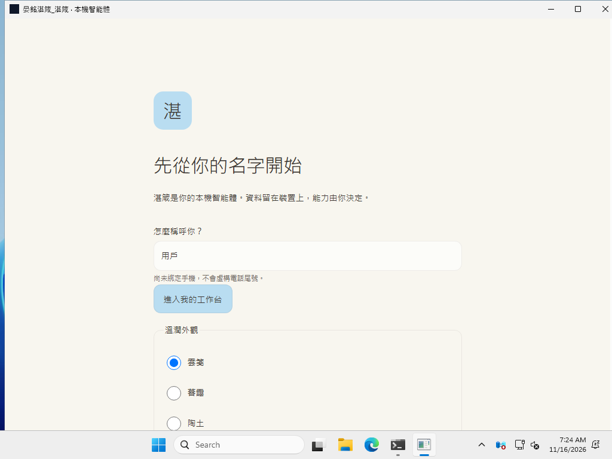

# 湛箴 · 你的本機編碼工作區

**不是只有文件盤點：現在可以讓模型提出程式修改，逐批授權，執行真實單元測試，根據失敗修正，再由你驗收或還原。**

- Windows portable：本次編碼 GUI／原生資料夾選擇器與實際任務驗收正在 CI 執行；最新成功產物會在此更新，不以舊盤點包冒充新版。
- 無需安裝 Node/Python；需要現有 **WebView2**。無 MSI／NSIS、無自訂註冊表持久化、無遙測；尚未簽章，SmartScreen 可能提示。
- 產品圖標使用你提供的原圖，未另畫替代品；四套精確溫潤主題。UI 使用原生表單／dialog 與固定 commit 的 **Lucide ISC** 圖示，原 React MIT 工作區仍保留。

### 打開後就能做

1. 填暱稱，啟用「編碼工作區」。
2. 按「建立離線程式修復示例」：新建中文／空白工作資料夾，**明確是假模型**；讀檔、修改、故意失敗測試、回饋修正、通過測試都走真實工具管線。
3. 每批審查檔案及工具；執行程式碼另行同意。通過後檢查完整前後差異，**驗收保留或還原**；想記住結果再明確確認。
4. 連接自己的模型：在「模型設定」啟用本機連線，填 Ollama／LM Studio 的 OpenAI 相容 base URL 與已下載模型名；用原生資料夾選擇器選專案，再輸入需求。**未設定模型會清楚阻止執行，不假裝已推論。** 本次沒有付費／NIM／live inference。

### 誠實的能力範圍

支援已選工作區的讀取／新增檔案／精確 patch、固定 Node `node:test`、失敗回饋再規劃、持久任務、差異審查／衝突保護／未驗收還原、確認後記憶。DSH 官方 MIT Cordis 真正擁有插件生命週期；這是自有 bounded coding loop，**不是完整上游 DSH／REA 的重包裝宣稱**。

首版每工作區最多 64 個文字檔、每檔 32 KiB，最多 6 輪／16 工具／8 次寫入；測試 3 秒／輸出 16 KiB，只接受 `.test.mjs` 使用 `node:test`。不自動安裝 npm、不開任意 shell、不提供任意插件隔離。Node 權限與路徑檢查**不是 OS 安全沙盒，也沒有網路隔離**；只核准你信任的測試。防止一般路徑穿越、symlink/junction/hardlink、已審查檔案遭變更；不能保證對抗同帳號惡意程式的競態或惡意測試偽造輸出。

支付寶接入現在由你自行完成；既有手動設定與 sandbox 原碼只保留，不繼續付款範圍，不收款、不入駐。其他完整 Loop 功能／多端發行／MCP 分析引擎／Office 預覽仍見原覆蓋表，沒有把保留原碼當成全數完成。

[編碼工具與安全設計](docs/coding/README.md) · [完整歷史要求／全部連結](docs/integration/COVERAGE.md) · [圖標來源](docs/integration/product-icon.lock.json) · [UI 授權](docs/integration/ui-components.lock.json)

### English

A usable bounded local coding workspace: provider plan → explicit workspace selection → per-batch tool approval → real file read/write/patch → bounded Node unit tests → failure feedback and repair → human diff acceptance or rollback → optional confirmed memory. The offline demonstration uses a clearly labeled deterministic fake model through the same provider/tool pipeline, not live inference. Bring your own local OpenAI-compatible model. Native Windows picker, supplied product icon, exact Wenrun themes, no custom registry persistence or telemetry. This is not an OS/network sandbox or an unrestricted coding agent. Alipay is now user-managed; no new payment implementation.

---

## 第一階段整合紀錄（原文、連結及原 README 完整保留）

# 晏銘湛箴_湛箴（ymzz-zhanzhen）

**我的本機 VibeCoding 智能體：三十輻共一轂，Skill 是可換的輻。**

> 首個可執行整合切片，並非完整產品交付。原有程式碼／功能／頁面／連結全部保留。新碼 MIT；第三方維持原授權。

- **真的會運作**：DSH 官方 MIT Cordis 插件內核 → 明確權限 → 無用之用規則調度 → 鎖定技能池 → Rust 文件驗證 → SQLite 任務與證據鏈 → 人工驗收 → 確認後記憶。
- **先離線驗證，再談智能**：20 項新 runtime/支付測試、4 項新 Rust gate 測試與原倉庫回歸；離線文件任務不冒稱模型推論。四套溫潤配色、暱稱先行、檔案選擇器、48px 熱區。
- **Windows 已有真實證據**：[CI 通過](https://github.com/Ya-MiC/ymzz-zhanzhen/actions/runs/43822844570)（`ee20094`，2026-11-16 16:24 KST）；搬至中文／空白目錄後真 GUI 啟動、點暱稱引導、bundled Rust 任務與證據驗證成功。[下載 x64 portable ZIP artifact](https://github.com/Ya-MiC/ymzz-zhanzhen/actions/runs/43822844570/artifacts/14205472160)。不是 MSI／公開 release，不安裝 Node/Python；需既有 WebView2。尚無手機發行包。
- **有界限的 DSH 衍生**：已核實 [官方原碼](https://github.com/deepseek-ai/deepseek-harness)，本切片實際編譯其 Cordis/Cosmokit，不假裝移植了完整 DSH Agent Loop。
- **來源完整可追**：Loop `product` 318 檔＋獨立 `main` 103 檔，另外保留三個模組；[逐檔來源 SHA、排除清單](docs/integration/sources.lock.json)。原目標實際是 Rust/React，不是規格所述 FastAPI/Vue。
- **支付不作假**：本機靜態收款碼 GUI＋可選 Alipay sandbox 簽名 adapter；無假 QR、無前端 paid 權威、無真實交易、無費率零元承諾。

### 你可以直接驗收

[操作與誠實狀態、Windows 驗收、已完成／未完成（繁中 → English）](docs/integration/README.md) · [全部要求覆蓋表與完整原連結](docs/integration/COVERAGE.md) · [九技能鎖檔](core-skills.lock.json) · [授權掃描](docs/integration/dependency-licenses.json) · [支付官方依據](docs/integration/PAYMENTS.md)

[稟冊引導／下載](https://bingce.yanmingx0215.filegear-sg.me/#onboarding) · [每日復盤與設定教學](https://ya-mic.github.io/ymzz-loop/) · [官網](https://ya-mic.github.io/yanming-official-website/) · [無用之用](https://ya-mic.github.io/ymzz-wuyong-zhi-yong/) · [無無即無](https://ya-mic.github.io/ymzz-wuwong-ji-wung/)

外部 Pages 的 `product` 分支部署仍被既有環境保護規則擋住；本次沒有修改規則、網域或路由，未假稱跨站反向入口已全部部署。Office 參考插件為 AGPL，只研究公開介面，不納入 MIT runtime；官網缺 LICENSE，僅原碼存檔不打包。

截圖來自 Windows runner（畫面系統鐘為 UTC）；上方驗收時間已換算 KST。未簽章的開發版可能出現 SmartScreen 提示；不保證所有 Windows 電腦皆已驗收。

### English

A runnable first vertical slice of a local-first, DSH-kernel-derived plugin agent runtime, not merely a redesigned site. It preserves all original target files plus pinned source snapshots, and executes a deterministic offline task with real Rust evidence, human acceptance and explicit memory consent. This is **not** a completed autonomous coding agent, live model test, production payment system, or already-verified multi-platform release. See the linked README for exact executable proof, Windows CI/artifacts, source hashes and remaining gaps. No releases/packages are published here.

---

## 原 README（完整保留）

# 晏銘湛箴 — README

晏銘湛箴 — 支付寶 PAYATHON 2026 · Vibe Pay 參賽作品。

把人說過的話當作「潑出去的水」，用量化分數、標籤、來源索引為每一句做注解，再與 AI 的輸出和思維鏈做星雲匹配。

## 品牌（第 1 節，逐字不得動）
- 名稱：晏銘湛箴
- 簡介：無無即無，zhanranchangji（清靜經原文）

## 技術棧
Rust + Tauri v2 + React 18 + TypeScript + Vite + pnpm

## 階段
P0 腳手架 → P1 核心與 Web 本地版 → P2 星雲 + 紅藍 + MockPay 閉環 + Web 公網 → P3 真實 Vibe Pay + 桌面三平台 → P4 手機與收尾 → P5 凍結

## 授權
程式碼 MIT；設計系統參考 ymzz-wenrun-design-skill（MIT）。
