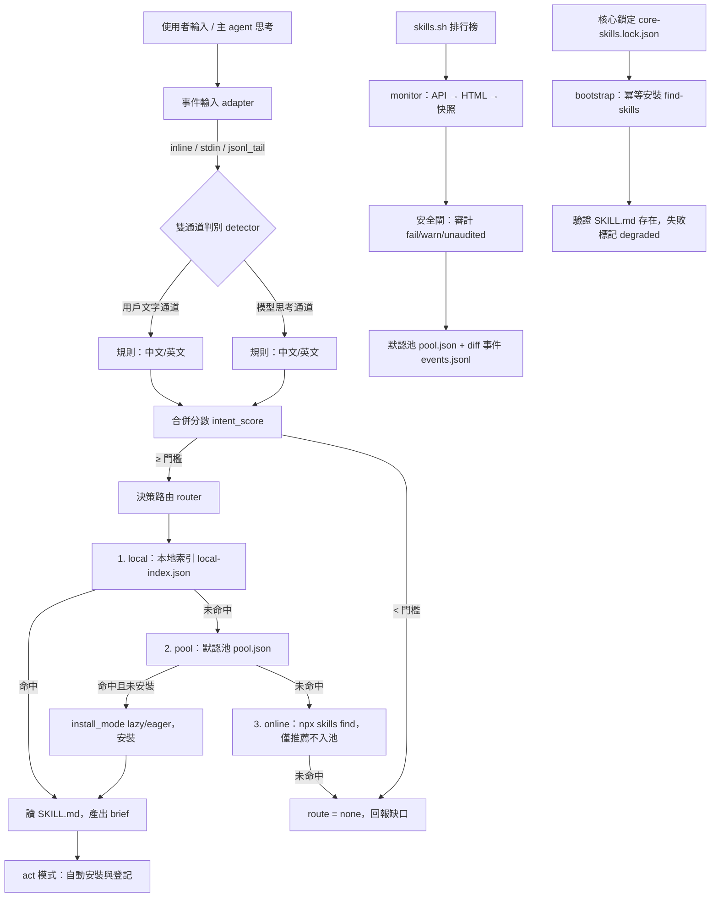

# 架構設計（晏銘湛箴_無用之用）

## 架構圖（Mermaid）

## 資料流向

1. **事件進入**：`sources/inline_src.py`（CLI）、`stdin_src.py`、`jsonl_tail.py` 將事件正規化為 `{conversation_id, turn_id, ts, user_text, thinking}`。
2. **雙通道判別**：`signals/detector.py` 分別掃描 `rules_zh.py` / `rules_en.py`；加權合併（思考通道略高）；可選 LLM 判官預設關閉；輸出 `DetectResult`。
3. **決策路由**：`router.py` 按 `local → pool → online → none`；命中後讀 `SKILL.md` 產出人話 brief；`act` 模式下自行安裝與登記。
4. **本地索引**：`registry/local_index.json`（`state/local-index.json`）跨對話共用，記錄 `origin_conversation_id`、`created_at`、`path`、`hash`；`harvest` 掃描本地根目錄（Claude Code、Codex、Cursor、`.agents` 等，只收存在者）。
5. **技能池**：`monitor/skills_sh.py` 三級降級（官方 API 需 `VERCEL_OIDC_TOKEN`，無則 HTML，HTML 失敗則快照標記 `stale`）；`pool.py` 套用安全閘、遲滯（連續 2 次低於門檻）、diff 事件（entered / left / installs_changed / hash_changed）。
6. **安裝**：`installer.py` 包裝 `npx skills add --skill … --yes --copy --json --json`，`DISABLE_TELEMETRY=1`，`dry_run` 模式不聯網；失敗不偽裝成功，標記 `degraded` 寫入 `state/`。

## 依賴邊界

- 運行時：零第三方 Python 依賴（tomllib、urllib、html.parser、pathlib、argparse、json）。
- 測試：pytest。
- Node：僅為 `npx skills`（安裝 find-skills 與線上查詢）。
- 對外網路：僅 `skills.sh` 與 `npx skills`（GitHub）；無遙測。

## 配置集中在 `config/wuyong.toml`

門檻 `min_installs`（預設 1,000,000，嚴格大於）、輪詢間隔（預設 6h）、本地根目錄、mode（observe/advise/act）、兩通道權重、install_mode、日誌脫敏。

## 狀態全部在 `state/`

- `local-index.json`：本地技能索引（跨對話）。
- `pool.json`：默認池記錄（{id, source, installs, installs_at, first_seen, last_seen, audit, hash, status, installed}）。
- `events.jsonl`：diff 事件日誌。
- `leaderboard-snapshot.json`：skills.sh 快照（降級備援，標記 stale）。
- `bootstrap.json`：bootstrap 結果。
